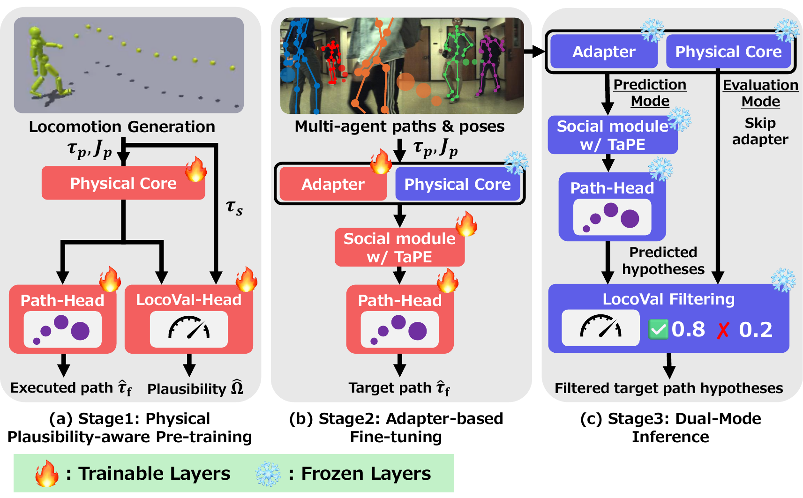

# Hexa-P: Physical Plausibility-aware Pre-training for Pedestrian Path Prediction

[Hiromu Taketsugu](https://iminthemiddle.github.io/)<sup>1</sup>, [Shohei Nobuhara](https://vision.is.kit.ac.jp/cv.en.html)<sup>2</sup>, [Norimichi Ukita](https://www.toyota-ti.ac.jp/Lab/Denshi/iim/ukita/index.html)<sup>1</sup>
<sup>1</sup> Toyota Technological Institute, <sup>2</sup> Kyoto Institute of Technology
**Pattern Analysis and Applications, 2026**

🌐 [Project page](https://iminthemiddle.github.io/Hexa-P-Page/) · 🤗 [Weights and data](https://huggingface.co/ImIntheMiddle/Hexa-P)

<p align="center"></p>

## 💡 Overview

Hexa-P pre-trains a pedestrian path predictor in a physics simulation.

1. **Stage 1, pre-training in IsaacGym.** A humanoid controller walks along random target paths. The Hexa-P network learns to predict the executed path from the observed motion (Path-Head) and to score how plausible a path is for the body (LocoVal-Head).
2. **Stage 2, fine-tuning on real data.** Bottleneck adapters on the frozen Physical Core and Target-relative Positional Encoding (TaPE) adapt the network to multi-agent datasets.
3. **Inference.** The network predicts path hypotheses with the adapters (Prediction Mode) and scores them without the adapters (Evaluation Mode) to filter out implausible ones.

## 🛠️ Installation

Hexa-P uses Python 3.8 (required by Isaac Gym Preview 4) and [uv](https://docs.astral.sh/uv/).

```bash
git clone https://github.com/ImIntheMiddle/Hexa-P.git
cd Hexa-P
uv sync
```

Stage 1 also needs [Isaac Gym Preview 4](https://developer.nvidia.com/isaac-gym). Download it and install it into the environment:

```bash
uv pip install --no-deps -e /path/to/isaacgym/python
```

> [!TIP]
> Evaluation and Stage-2 training run without Isaac Gym.

Run all commands below from the repository root.

## 📦 Weights and data

```bash
uv run hf download ImIntheMiddle/Hexa-P --local-dir .
```

This downloads the preprocessed windows of JTA, JRDB and Urban (`vru` in the code) and five checkpoints. Read the licences in the [Hugging Face README](https://huggingface.co/ImIntheMiddle/Hexa-P) before you download.

| Checkpoint | Content |
|---|---|
| `weights/stage1/hexap_pretrain.ckpt` | Hexa-P network after Stage 1 |
| `weights/stage1/hexap_pretrain_deterministic.ckpt` | The same with one hypothesis |
| `weights/stage1/controller.ckpt` | Path-following controller of the simulation |
| `weights/stage2/{jrdb,jta}/hexap.pt` | Hexa-P fine-tuned on JRDB and JTA |

## 📊 Evaluation

```bash
uv run python -m hexap.evaluate weights/stage2/jrdb/hexap.pt                       # JRDB
uv run python -m hexap.evaluate weights/stage2/jta/hexap.pt                        # JTA
uv run python -m hexap.evaluate weights/stage2/jrdb/hexap.pt --limit-obs 2         # two observed frames
uv run python -m hexap.evaluate weights/stage2/jrdb/hexap.pt --filter-threshold 0.6  # LocoVal filtering
```

The output lists ADE, FDE (averaged over the hypotheses), minADE, minFDE, and the chi-square distances of speed, acceleration, angular velocity and angular acceleration between prediction and ground truth. With `--filter-threshold`, it also lists the hypotheses kept and rejected by LocoVal filtering.

## 🏋️ Training

### Stage 1 (optional): pre-training in the physics simulation

Skip this stage to fine-tune the released `weights/stage1/hexap_pretrain.ckpt`. Stage 1 needs Isaac Gym, the SMPL body model and the AMASS motions listed in `src/hexap/data/stage1_motions.yaml`.

1. Register at [AMASS](https://amass.is.tue.mpg.de/) and [SMPL](https://smpl.is.tue.mpg.de/), and put the SMPL body models (`SMPL_NEUTRAL.pkl` and the others) in `data/smpl/`.
2. Convert the SMPL-H AMASS files and package the clips:

   ```bash
   uv run python third_party/protomotions/data/scripts/convert_amass_to_isaac.py /path/to/amass --humanoid-type smpl
   uv run python third_party/protomotions/data/scripts/package_motion_lib.py \
       src/hexap/data/stage1_motions.yaml /path/to/amass data/motions/stage1_motions.pt
   ```

3. Train the path-following controller, then the Hexa-P network on its rollouts:

   ```bash
   uv run python -m hexap.stage1.train +exp=hexap/controller +robot=smpl +simulator=isaacgym \
       +motion_file=data/motions/stage1_motions.pt +experiment_name=controller
   uv run python -m hexap.stage1.train +exp=hexap/pretrain +robot=smpl +simulator=isaacgym \
       +motion_file=data/motions/stage1_motions.pt checkpoint=results/controller/last.ckpt \
       +experiment_name=hexap_pretrain
   ```

Checkpoints are written to `results/<experiment_name>/`. The configurations simulate 4096 environments on an 80 GB GPU; add `num_envs=1024` on a 48 GB GPU.

### Stage 2: fine-tuning on a real dataset

```bash
uv run python -m hexap.train dataset=jrdb model=hexap pretrained=weights/stage1/hexap_pretrain.ckpt
```

- `dataset`: `jta`, `jrdb` or `vru`.
- `pretrained`: the released Stage-1 network, or your own from `results/hexap_pretrain/`.
- Deterministic prediction: add `model.nmode=1 pretrained=weights/stage1/hexap_pretrain_deterministic.ckpt`.
- Checkpoints are written to `outputs/stage2/<dataset>_hexap/`.

## 🗂️ Data preparation

The downloaded windows are enough for all commands above. To build them yourself:

```bash
uv run python -m hexap.data.preprocess jta --source /path/to/social-transmotion/jta/data
uv run python -m hexap.data.preprocess vru --source /path/to/vru/pedestrians
```

- `jta` reads the JTA windows of the [Social-Transmotion release](https://github.com/vita-epfl/social-transmotion/releases/tag/ckpt_data).
- `vru` reads `training_validation.zarr` and `test.zarr` of [Pedestrians and Cyclists in Road Traffic](https://doi.org/10.5281/zenodo.4898838).
- `jrdb` inserts SMPL joints into the 2D-box windows of the Social-Transmotion release. The joints are regressed from the JRDB images with BEV, following [T2P](https://github.com/Jaewoo97/T2P).

## 📝 Citation

```bibtex
@article{taketsugu2026hexap,
  title   = {Hexa-P: Physical Plausibility-aware Pre-training for Pedestrian Path Prediction},
  author  = {Taketsugu, Hiromu and Nobuhara, Shohei and Ukita, Norimichi},
  journal = {Pattern Analysis and Applications},
  year    = {2026}
}
```

## ⚖️ License

Our code is released under the [Apache License 2.0](LICENSE), except `src/hexap/stage1/env.py` (NVIDIA License, derived from ProtoMotions) and `src/baselines/social_transmotion.py` (AGPL-3.0, derived from Social-Transmotion). The code in `third_party/` keeps the license of its upstream project.

## 🙏 Acknowledgements

Hexa-P builds on [ProtoMotions](https://github.com/NVlabs/ProtoMotions), [PACER](https://github.com/nv-tlabs/PACER), [Social-Transmotion](https://github.com/vita-epfl/social-transmotion), [T2P](https://github.com/Jaewoo97/T2P), [CrowdNav++](https://github.com/Shuijing725/CrowdNav_Prediction_AttnGraph), [Pytorch-PCGrad](https://github.com/WeiChengTseng/Pytorch-PCGrad), [Isaac Gym](https://developer.nvidia.com/isaac-gym), and the AMASS, JTA, JRDB and Urban datasets. `third_party/` holds the files of ProtoMotions, Social-Transmotion, Pytorch-PCGrad and CrowdNav++ that Hexa-P uses, without changes.
